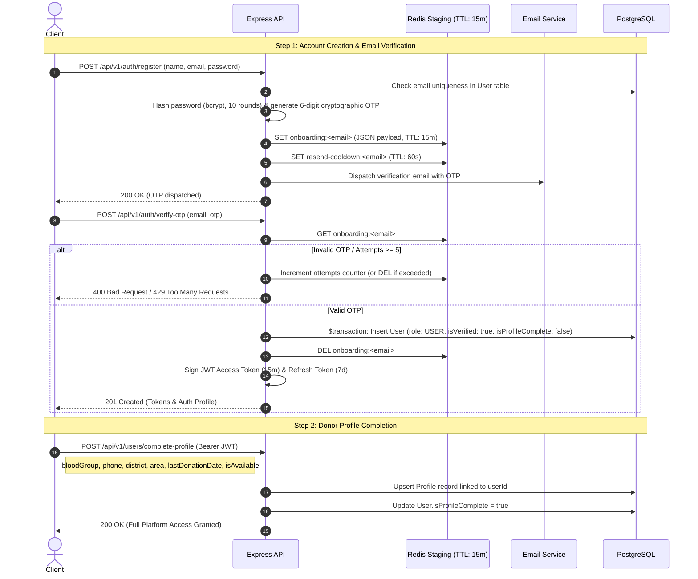
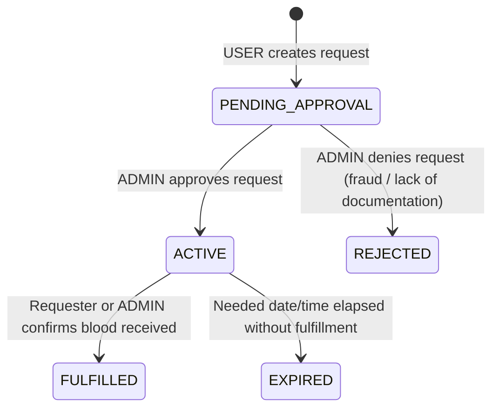

# System Architecture & Technical Specifications (ARCHITECTURE.md)

This document establishes the authoritative system architecture, domain models, and architectural decisions for the Blood Donation Platform MVP backend. All automated agents, developers, and code generators must strictly adhere to these specifications.

---

## 1. System Overview & Architectural Directives

The platform facilitates emergency and planned blood donations by connecting recipients with verified donors. It enforces deterministic request lifecycles, strict medical compatibility, and data cleanliness.

### Core Stack

- **Runtime:** Node.js (v20+)
- **Language:** TypeScript 5 (Strict Mode, `ESNext`, `moduleResolution: bundler`)
- **Web Framework:** Express.js 4
- **Database:** PostgreSQL (via Prisma 7 ORM)
- **Staging & Caching:** Redis (`ioredis` or Node Redis)
- **Validation & Schema Inference:** Zod (Single source of truth)
- **API Documentation:** OpenAPI 3.0 via `@asteasolutions/zod-to-openapi` & `swagger-ui-express`
- **Linting & Formatting:** Biome

### Modular Domain Isolation

The codebase adheres to a Feature-Sliced Modular Architecture:

- `src/modules/auth`: Two-step staged registration, OTP delivery, session tokens.
- `src/modules/users`: Profile completion, donor availability, location metadata.
- `src/modules/requests`: Blood request lifecycle, admin approval gate, filtering.
- `src/modules/responses`: Donor matching, eligibility checks, mutual contact sharing.

---

## 2. Decision Record: 2-Step Onboarding with Redis Data Staging

### Problem

Traditional user registration persists unverified accounts directly into the relational database. In blood donation and emergency platforms, abandoned registrations, mistyped emails, and spam bots rapidly degrade primary key sequences, inflate database size, and necessitate complex background pruning jobs.

### Architectural Decision

Registration is decoupled into a **Two-Step Onboarding Architecture** utilizing Redis as an ephemeral staging area.



### Redis Key Taxonomy & Abuse Controls

| Key Format                | Type          | TTL             | Purpose / Rule                                                                     |
| :------------------------ | :------------ | :-------------- | :--------------------------------------------------------------------------------- |
| `onboarding:<email>`      | String (JSON) | `900s` (15 min) | Holds `{ name, email, passwordHash, otp, attempts }`. Auto-purged on expiration.   |
| `resend-cooldown:<email>` | String        | `60s` (1 min)   | Enforces 60-second cooldown between consecutive OTP resend requests.               |
| `otp-attempts:<email>`    | Counter       | `900s`          | Maximum 5 invalid attempts per session before the session is forcibly invalidated. |

---

## 3. Decision Record: Blood Requests & Matching Engine

### 1. Request State Machine

All blood requests strictly follow deterministic lifecycle states as dictated by `AGENTS.md`:



- **`PENDING_APPROVAL`**: Request is created and queued for human or administrative audit. It is strictly hidden from the public donor feed.
- **`ACTIVE`**: Admin-approved request. Visible to the public feed and open for donor matching and responses.
- **`REJECTED`**: Denied request. Requires a logged administrative reason.
- **`FULFILLED`**: Target units achieved. Request closes and is removed from the active donor feed.

---

### 2. Matching Engine & Donor Response Rules

#### A. Strict Blood Group Matching (MVP Rule)

For the MVP, blood group matching enforces **Strict Exact Match**:
$$\text{Donor.bloodGroup} \equiv \text{Request.bloodGroup}$$
Cross-match biological compatibilities (e.g., $O^-$ universal donor) are deferred to post-MVP to minimize medical screening discrepancies in the initial release.

#### B. Multiple Responders per Request

- Multiple unique donors may respond to a single request (e.g., when a patient requires multiple units of blood or requires backup donors).
- **Anti-Spam Invariant**: A donor can only submit **one** active response per request. Enforced via the compound database constraint:
  `@@unique([requestId, donorId])`

#### C. Donor Eligibility & 90-Day Cooldown Gate

When a donor attempts to respond to an active request, the response service validates:

1. **Self-Donation Guard**: `request.requesterId !== donor.id`.
2. **Profile Completion**: `donor.isProfileComplete === true`.
3. **Availability Flag**: `donor.profile.isAvailableForDonation === true`.
4. **90-Day Recovery Cooldown**:
   If `donor.profile.lastDonationDate` is not null:
   $$\Delta t = \text{CurrentTime} - \text{donor.profile.lastDonationDate} \ge 90\text{ days}$$
   If $\Delta t < 90\text{ days}$, the response is rejected with HTTP 400 (`AppError`).

#### D. Mutual Contact Sharing

To preserve donor privacy while expediting emergency logistics:

- Unauthenticated users and non-participating donors cannot view donor or requester phone numbers.
- Upon a successful `DonationResponse`:
    - The **Donor** is returned the requester's `contactNumber`, `patientName`, and `hospitalName`.
    - The **Requester** can query `GET /api/v1/requests/:id/responses` to view all responding donors with their verified `name`, `phone`, `bloodGroup`, and donation track record.

---

## 4. Complete Database Schema (PostgreSQL via Prisma 7)

```prisma
datasource db {
  provider = "postgresql"
}

generator client {
  provider = "prisma-client-js"
}

enum Role {
  USER
  ADMIN
}

enum RequestStatus {
  PENDING_APPROVAL
  ACTIVE
  REJECTED
  FULFILLED
}

enum UrgencyLevel {
  NORMAL
  URGENT
  EMERGENCY
}

enum BloodGroup {
  A_POS
  A_NEG
  B_POS
  B_NEG
  AB_POS
  AB_NEG
  O_POS
  O_NEG
}

enum ResponseStatus {
  INTERESTED
  ACCEPTED
  REJECTED
  CANCELLED
}

model User {
  id                String             @id @default(uuid())
  email             String             @unique
  name              String
  passwordHash      String
  role              Role               @default(USER)
  isVerified        Boolean            @default(false)
  isProfileComplete Boolean            @default(false)
  createdAt         DateTime           @default(now())
  updatedAt         DateTime           @updatedAt

  profile           Profile?
  bloodRequests     BloodRequest[]     @relation("RequesterRelation")
  donationResponses DonationResponse[] @relation("DonorRelation")

  @@index([email])
}

model Profile {
  id                     String      @id @default(uuid())
  userId                 String      @unique
  user                   User        @relation(fields: [userId], references: [id], onDelete: Cascade)
  bloodGroup             BloodGroup
  phone                  String      @unique
  district               String
  area                   String
  lastDonationDate       DateTime?
  isAvailableForDonation Boolean     @default(true)
  createdAt              DateTime    @default(now())
  updatedAt              DateTime    @updatedAt

  @@index([bloodGroup, district, isAvailableForDonation])
}

model BloodRequest {
  id              String             @id @default(uuid())
  requesterId     String
  requester       User               @relation("RequesterRelation", fields: [requesterId], references: [id])
  patientName     String
  bloodGroup      BloodGroup
  unitsNeeded     Int                @default(1)
  hospitalName    String
  district        String
  area            String
  urgency         UrgencyLevel       @default(NORMAL)
  neededAt        DateTime
  contactNumber   String
  additionalNotes String?
  status          RequestStatus      @default(PENDING_APPROVAL)
  rejectionReason String?
  createdAt       DateTime           @default(now())
  updatedAt       DateTime           @updatedAt

  responses       DonationResponse[]

  @@index([status, bloodGroup, district])
  @@index([neededAt])
}

model DonationResponse {
  id           String         @id @default(uuid())
  requestId    String
  request      BloodRequest   @relation(fields: [requestId], references: [id], onDelete: Cascade)
  donorId      String
  donor        User           @relation("DonorRelation", fields: [donorId], references: [id])
  status       ResponseStatus @default(INTERESTED)
  donorMessage String?
  createdAt    DateTime       @default(now())
  updatedAt    DateTime       @updatedAt

  @@unique([requestId, donorId])
  @@index([requestId, status])
}
```

---

## 5. API Route Matrix & Access Control

### Authentication & Onboarding (`/api/v1/auth`)

| Status | Method | Path                         | Auth                   | Description                                             |
| :----- | :----- | :--------------------------- | :--------------------- | :------------------------------------------------------ |
| ✅     | `POST` | `/api/v1/auth/register`      | Public                 | Stage registration in Redis, dispatch email OTP         |
| ✅     | `POST` | `/api/v1/auth/verify-otp`    | Public                 | Verify OTP, commit User to DB, issue JWT tokens         |
| ✅     | `POST` | `/api/v1/auth/resend-otp`    | Public (Rate-limited)  | 60-second cooldown check, dispatch new OTP              |
| ✅     | `POST` | `/api/v1/auth/login`         | Public                 | Authenticate existing user, issue JWT tokens            |
| ✅     | `POST` | `/api/v1/auth/refresh-token` | Public (Cookie / Body) | Verify refresh token, rotate session, issue new tokens  |

### User Profile (`/api/v1/users`)

| Status | Method  | Path                             | Auth   | Description                                         |
| :----- | :------ | :------------------------------- | :----- | :-------------------------------------------------- |
| ❌     | `POST`  | `/api/v1/users/complete-profile` | `USER` | Step 2 profile setup (blood group, phone, district) |
| ❌     | `GET`   | `/api/v1/users/me`               | `USER` | Get authenticated user profile and donation metrics |
| ❌     | `PATCH` | `/api/v1/users/availability`     | `USER` | Toggle `isAvailableForDonation`                     |

### Blood Requests (`/api/v1/requests`)

| Status | Method  | Path                           | Auth                      | Description                                    |
| :----- | :------ | :----------------------------- | :------------------------ | :--------------------------------------------- |
| ❌     | `POST`  | `/api/v1/requests`             | `USER` (Profile Complete) | Create new request (enters `PENDING_APPROVAL`) |
| ❌     | `GET`   | `/api/v1/requests`             | Public / `USER`           | Filter & paginate `ACTIVE` requests            |
| ❌     | `GET`   | `/api/v1/requests/:id`         | Public / `USER`           | Retrieve request details                       |
| ❌     | `PATCH` | `/api/v1/requests/:id/fulfill` | Requester / `ADMIN`       | Mark request as `FULFILLED`                    |

### Donor Response Management (`/api/v1/requests/:id/responses`)

| Status | Method | Path                             | Auth                      | Description                                              |
| :----- | :----- | :------------------------------- | :------------------------ | :------------------------------------------------------- |
| ❌     | `POST` | `/api/v1/requests/:id/responses` | `USER` (Profile Complete) | Respond to active request (Strict match + 90d check)     |
| ❌     | `GET`  | `/api/v1/requests/:id/responses` | Requester / `ADMIN`       | List all responding donors with verified contact details |

### Administrative Oversight (`/api/v1/admin`)

| Status | Method  | Path                                 | Auth    | Description                                  |
| :----- | :------ | :----------------------------------- | :------ | :------------------------------------------- |
| ❌     | `GET`   | `/api/v1/admin/requests/pending`     | `ADMIN` | List all requests awaiting verification      |
| ❌     | `PATCH` | `/api/v1/admin/requests/:id/approve` | `ADMIN` | Transition request to `ACTIVE`               |
| ❌     | `PATCH` | `/api/v1/admin/requests/:id/reject`  | `ADMIN` | Transition request to `REJECTED` with reason |

---

## 6. Implementation Sequence & Execution Order

When proceeding to code implementation, tasks must follow this strict dependency order:

1. **Infrastructure Connections:** Initialize Redis client with connection lifecycle management (`connectRedis`, `disconnectRedis`). Configure Nodemailer with SMTP/Ethereal support.
2. **Data Modeling:** Initialize Prisma schema, generate client, and execute PostgreSQL migration.
3. **Module 1 - Auth (Step 1):** Build Redis staging service, OTP generator, email dispatcher, and verification endpoint.
4. **Module 2 - User Profile (Step 2):** Implement profile completion endpoint and user availability state management.
5. **Module 3 - Requests:** Implement request creation (`PENDING_APPROVAL`), admin approval/rejection gates, and public feed filtering.
6. **Module 4 - Donor Matching & Responses:** Implement strict matching engine, 90-day donation cooldown validation, and mutual contact disclosure.
